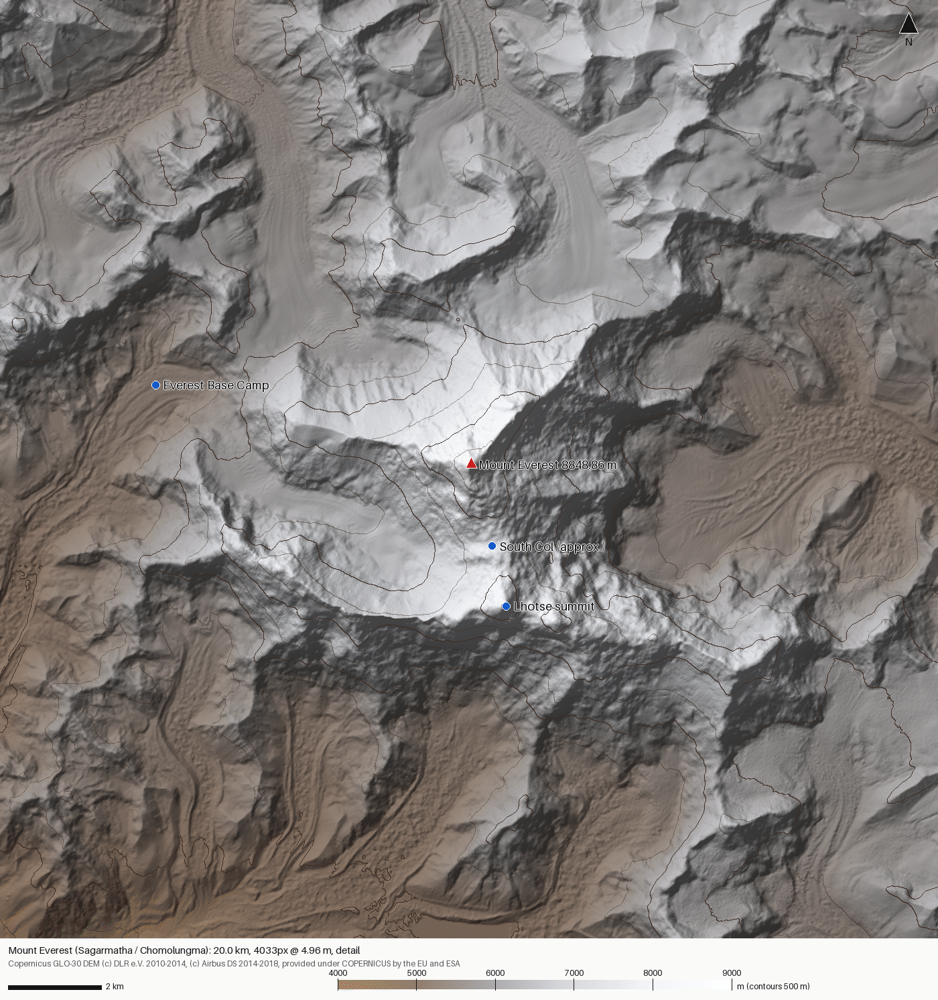
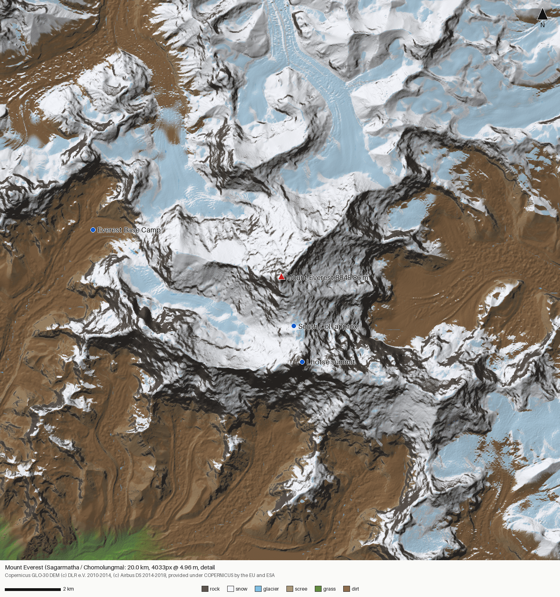

# SUMMIT terrain pipeline: real mountains to UE5 Landscapes

`summit_terrain.py` turns free, real elevation data into Unreal Engine 5 Landscape heightmaps
at true scale, for any mountain on Earth. For each build you get:

- a 16-bit grayscale PNG and a `.r16` RAW heightmap (little-endian), sized to an Epic-recommended
  Landscape resolution;
- 8-bit paint-layer weightmaps (rock, snow, glacier, scree, grass, dirt) that sum to 255 per pixel;
- `<name>.json`: centre, projection (WKT and PROJ), extent, pixel size, min and max elevation, and the
  **exact UE import settings** (Location, Scale, section layout, `SeaLevelWorldZCm`);
- a hillshade preview with 500 m contours and a paint-layer composite preview.




## Install

```bash
python3 -m venv .venv && . .venv/bin/activate      # optional
pip install -r Tools/terrain/requirements.txt       # rasterio wheels bundle GDAL
```

You need Python 3.10 or later. The pipeline was tested with Python 3.13, rasterio 1.5.2, pyproj 3.8,
numpy 2.5, scipy 1.18 and Pillow 12.3.

## Run

```bash
cd Tools/terrain
python summit_terrain.py presets                       # list the 21 built-in peaks
python summit_terrain.py check-presets                 # compare presets with the DEM (HTTP range reads)
python summit_terrain.py fetch --peak-id everest --extent-km 20
python summit_terrain.py build --peak-id everest --extent-km 20 --ue-size 4033 --detail --fit-landmarks
python summit_terrain.py preview --metadata output/everest/everest.json --width 1400 \
    --out ../../Docs/images/everest_hillshade.png
python summit_terrain.py preview --metadata output/everest/everest.json --layers --width 1400 \
    --out ../../Docs/images/everest_layers.png

# any point on Earth, auto size: 16 km at <= 2 m/px picks 8129 (1.97 m/px)
python summit_terrain.py build --lat 46.5775 --lon 8.0053 --name eiger --elevation-m 3967 \
    --extent-km 16 --resolution-m 2 --ue-size auto

# huge areas: 2x2 World Partition tiles of 4033 (8065 px total), one shared Z scale
python summit_terrain.py build --peak-id k2 --extent-km 40 --ue-size 4033 --tiles 2 --detail

# your own better DEM (any CRS, any number of same-CRS GeoTIFF tiles)
python summit_terrain.py build --peak-id matterhorn --source swissalti3d_mosaic.tif --resolution-m 1
```

`fetch` stores tiles in `Tools/terrain/cache/`, and `build` writes to `Tools/terrain/output/<name>/`.
Both directories are gitignored. Never commit raw DEMs; heightmaps that the game ships go to `Content/`
through Git LFS (see the root `CLAUDE.md`).

### What `build` does

1. **Tiles.** It works out which Copernicus GLO-30 1x1° tiles cover the square plus 2 km, then
   downloads the missing ones. Ocean tiles return 404 and are treated as 0 m. A `.missing` marker
   stops them being requested again. Land tiles withheld from the 30 m public release fall back to
   GLO-90.
2. **Mosaic.** It merges the tiles pixel-exactly, with bounds snapped to the source grid, so tile seams
   get no resampling and no NaN rows.
3. **Reprojection.** It reprojects to a local metric projection centred on the peak: Azimuthal
   Equidistant by default, or `--projection tmerc` for a local Transverse Mercator with k0 = 1. Both
   keep distances true near the peak, so 1 UE unit is 1 real cm. Reprojection, cropping to the square
   and **cubic** resampling to the UE size happen in a single interpolation step.
4. **Optional `--detail`.** See *Sub-30 m detail* below.
5. **Summit clamp.** Copernicus reads 40 to 150 m low on sharp summits (see *Data limits*). The highest
   DEM pixel within 200 m of the surveyed coordinate is raised to the official height with a
   raised-cosine bump of radius max(250 m, 3 × correction). The added slope stays under about 30°.
   Landmarks flagged `"summit": true`, such as Lhotse in the Everest preset, get the same treatment.
   Turn it off with `--no-summit-clamp`.
6. **Encoding.** Heights are normalised to the build's min/max range, rounded down/up to 0.1 m, and
   written as 16-bit PNG and `.r16`. Use `--z-min`/`--z-max` to force a shared range across several
   builds.
7. **Paint layers.** It writes the paint-layer masks, the previews and the JSON.

## UE import settings, derived

UE stores a Landscape height as a uint16 `h`. `LandscapeDataAccess.h` defines
`LANDSCAPE_ZSCALE = 1/128`, and the landscape-local height is `(h - 32768) / 128`:

```
WorldZ_cm = Location.Z + (h - 32768) / 128 * Scale.Z
```

With `Scale.Z = 100`, the 65 536 steps span 65 536 / 128 × 100 cm = 512 m (-256 m to +256 m). That is
the documented "Z scale 100 = 512 m". The pipeline normalises `h = round((alt - min) / (max - min) * 65535)`,
so the centimetres per step must equal `(max - min) × 100 / 65535`:

```
Scale.Z      = (max_m - min_m) * 12800 / 65535      (≈ range_m / 512 * 100)
Scale.X = Scale.Y = pixel_size_m * 100
Location.X = Location.Y = -(N - 1) / 2 * Scale.X     (peak at world X = Y = 0)
Location.Z   = 100 * min_m + SeaLevelWorldZCm + 256 * Scale.Z
altitude_m   = (WorldZ_cm - SeaLevelWorldZCm) / 100  (= WorldZ_cm / 100 + sea_level_offset_m)
precision    = Scale.Z / 128 cm per step             (= range / 65535)
```

`--z-origin` chooses where world Z = 0 lies. The JSON always gives the matching
`sea_level_world_z_cm`; put that into `SummitSettings.SeaLevelWorldZCm`.

| `--z-origin` | World Z = 0 is | Location.Z | Notes |
|---|---|---|---|
| `mid` (default) | the middle of the height range | 0 | Smallest coordinates and best float precision. |
| `min` | the lowest point | 256 × Scale.Z | Simple for designers. |
| `sealevel` | 0 m altitude | 100·min + 256·Scale.Z | World Z equals real altitude. Large World Coordinates handle 9 km. |

Axes: UE +X is east and UE +Y is **south**. Row 0 of the image is the north edge, at the most
negative Y. North is therefore the -Y direction in the game.

### Recommended Landscape sizes

| Heightmap | Section size | Sections/component | Components | Total |
|---|---|---|---|---|
| 1009x1009 | 63x63 | 2x2 | 8x8 | 64 |
| 2017x2017 | 63x63 | 2x2 | 16x16 | 256 |
| 4033x4033 | 63x63 | 2x2 | 32x32 | 1024 |
| 8129x8129 | 127x127 | 2x2 | 32x32 | 1024 |

Each size satisfies `N - 1 = quads/section × sections/component × components`. The heightmap therefore
maps 1:1 onto vertices: UE does not pad, stretch or resample on import, and `Scale.X` is exactly the
real pixel size. 63- and 127-quad sections are the sizes Epic's LOD and heightmap-mip system is built
around, with power-of-two-minus-one quads. Epic advises keeping the component count around 1024 or
below, because each component carries a CPU and draw-call cost. 4033 is the largest size at 63-quad
sections within that budget. 8129 keeps 1024 components by doubling the section size. Beyond that,
use `--tiles N`: N×N Landscapes or streaming proxies that share edge vertices, one Location.Z and one
Scale.Z, named `<name>_x{i}_y{j}`, plus a `<name>_full.png` for a single World Partition import.

`--ue-size auto` picks the smallest size whose pixel size is ≤ `--resolution-m`.

## Importing into UE5 (5.3 or later)

1. **Landscape mode → Manage → New → Import from File.** Pick `<name>.png` or `<name>.r16`. Set Location,
   Rotation (0, 0, 0) and Scale from `ue_import` in the JSON, which `build` also prints. Check that
   Section Size, Sections Per Component and Number of Components match `landscape_layout`. Overall
   Resolution must equal the file size.
2. **World Partition.** In a World Partition level, tick *Enable World Partition* in the New Landscape
   panel and set *World Partition Region Size* (in components; 2 to 4 is typical). UE splits the
   Landscape into Landscape Streaming Proxies, which keeps a 20 km mountain streaming. For `--tiles`
   builds, either import `<name>_full.png` as one landscape, or import each `_x{i}_y{j}` tile with its
   own Location from `ue_import.tiles`. The tiles share edge vertices, Scale and Location.Z.
3. **Nanite Landscape (5.3 and later).** In Landscape Details → Nanite, tick *Enable Nanite* and run
   *Build Nanite Data*. You get much better close-range silhouettes on cliffs and ridges for the cost of
   a Nanite mesh per proxy. Keep a non-Nanite fallback for physics, which uses the heightfield anyway.
4. **Paint layers.** Create a weight-blended `LandscapeLayerInfoObject` for each of rock, snow,
   glacier, scree, grass and dirt. In Paint mode → Target Layers, right-click each layer and choose
   *Import from file* with `layers/<name>_layer_<layer>.png`. The weights sum to 255.
5. **Landscape material.** Use a Landscape Layer Blend (weight-blended) with the six layers. Feed
   each layer from Megascans or Fab surfaces: granite or gneiss cliff for rock, wind-packed snow, blue
   glacier ice with crevasse normals, talus or scree, alpine grass, and moraine dirt. For an
   **auto-material**, keep the painted masks as the macro distribution and add in-shader rules:
   world-aligned slope (`dot(VertexNormalWS, up)`) for rock on steep tiles, height plus noise for the
   snowline, and distance-blended macro variation to hide tiling. The masks follow the same
   slope/height/aspect logic, so painted and procedural results agree.
6. **Runtime Virtual Texturing.** Add a Runtime Virtual Texture Volume that bounds the landscape, and
   have the landscape material write BaseColor, Normal and Roughness into an RVT. At distance, sample
   the RVT instead of the full six-layer blend, which makes the far view of a 20 km mountain cheap.
   Use the same RVT to blend rocks, tents and fixed ropes into the terrain.
7. In game, convert world Z to altitude with `SummitSettings.SeaLevelWorldZCm`, which comes from the JSON.
   Everything else in the simulation (pressure, temperature, physiology) needs true altitude.

## Sub-30 m detail (`--detail`)

Upsampling 30 m data to 1 to 5 m only adds smoothness. `--detail` adds plausible micro-relief
deterministically: the same `--seed` gives the same terrain.

- **Noise.** Multi-octave noise is added at wavelengths below what the DEM resolves: 64 m, 32 m, 16 m
  and so on, down to 2.5 px. Every octave uses a randomly rotated lattice, so no grid artefacts appear.
  Steep terrain (25° to 50°, smoothstep) gets ridged noise with a standard deviation of 5 % of the
  wavelength: fractal rock with crests and gullies. Gentle terrain gets smooth noise at about 1 % with
  damped high octaves, which reads as snow-smoothed.
- **High-pass.** The noise is high-passed with a Gaussian of σ = 15 m, so it never shifts the mean
  surface.
- **Thermal erosion.** 200 iterations (`--erosion-iters`) of 4-neighbour thermal erosion follow Musgrave
  et al. 1989. The talus angle is relative to the real slope: max(33°, base slope + 10°). Real cliffs
  stay, while synthetic over-steep spikes collapse into scree aprons.
- **Low-frequency restore.** `out = eroded + gaussian(original - eroded, 15 m)`. Every wavelength above
  about 60 m is the real DEM again, so peaks, cols and valleys do not move. The summit clamp runs after
  this step.

## Paint layers

| Layer | Rule |
|---|---|
| rock | slope 38° to 48° and above (smoothstep). Snow cannot hold above about 45° to 58°. |
| snow | above the snowline, which is lowered by up to `--snow-aspect-amp-m` (300 m) on poleward faces, has ±80 m of noise breakup, and only applies where slope allows snow |
| glacier | slope below 15° to 25°, catchment of at least 0.3 km² (D8 flow accumulation after depression filling), from 900 m below the snowline upward, plus low-slope névé above it |
| scree | 22° to 45° slopes below the snowline, boosted under cliffs |
| grass | below `grassline_m`, slope below about 30° |
| dirt | the remainder: moraine, bare ground, trails |

Snowline and grassline come from the preset (Khumbu: 5700 m and 4800 m), or from a rough latitude
table. Override them with `--snowline-m` and `--grassline-m`.

## Reference build: Everest

Command: `build --peak-id everest --extent-km 20 --ue-size 4033 --detail --fit-landmarks`. It took about
3 min 15 s on 4 cores, mostly thermal erosion at about 0.5 s per iteration on 16 M pixels.

| Item | Value |
|---|---|
| Grid | 4033 x 4033, 20.000 km, 4.9603 m/px, AEQD centred on 27.98811 N, 86.92499 E |
| Tiles | N27E086, N27E087, N28E086, N28E087 (the square plus 2 km crosses 28° N and 87° E) |
| Elevation range | 4410.4 to 8848.9 m (range 4438.5 m), 6.77 cm per 16-bit step |
| UE Location | X -1 000 000, Y -1 000 000, Z 0 cm (`--z-origin mid`) |
| UE Scale | X 496.031746, Y 496.031746, Z 866.907759 |
| Layout | 63x63 quads, 2x2 sections, 32x32 components |
| `SeaLevelWorldZCm` | -662 968.386 (altitude = WorldZ/100 + 6629.684 m) |
| Summit, source DEM | 8737.79 m local max, 130 m NNE of the surveyed coordinate (8720.6 m at the coordinate) |
| Summit vs 8848.86 m | **-111.07 m** in Copernicus. Clamped with +110.37 m (r = 331 m) to 8848.832 m (-2.8 cm quantisation) |
| Lhotse vs 8516 m | -100.0 m in Copernicus (8415.98). Clamped to 8516.0 |
| Everest Base Camp (28.0043 N, 86.8571 E) | inside (x -6.68 km, y +1.80 km). DEM 5304.6 m vs the signposted 5364 m: **-59.7 m**. The camp sits on the thinning Khumbu glacier. |
| South Col (approx. coordinate) | DEM 7848.6 m vs 7906 m (-57 m) |
| Detail shift | mean 0.43 m, p99 2.8 m. 82 raw-DEM peaks moved on average 0.19 m, at most 1.03 m |
| Layer coverage | rock 14 %, snow 42.7 %, glacier 6.5 %, scree 7 %, grass 0.9 %, dirt 28.9 % |

## Data limits and better sources

**Copernicus GLO-30** is a 1 arc-second (about 30 m) **DSM**, with heights relative to the EGM2008
geoid. Its effective resolution is about 2 to 3 posts (60 to 90 m), so anything narrower than a couple
of rope lengths is interpolated. Sharp summits read low because the summit falls between posts, and
TanDEM-X voids on steep faces were filled from other DEMs. `check-presets` measured these offsets:
Everest -111 m, Matterhorn -153 m, Ama Dablam -152 m, Annapurna I -136 m, Manaslu -122 m, Lhotse
-100 m, Carstensz -95 m. Flatter or ice-capped summits are close: Mont Blanc +5 m, Vinson -2 m,
Kilimanjaro -9 m. X-band radar also penetrates dry snow and firn by a few metres. Treat the DEM as the
macro shape, and use the summit clamp, `--detail` and hand-placed Nanite rock for the climb itself.

Plug in any better GeoTIFF with `--source path.tif` (repeatable; any CRS, same CRS across files). The
pipeline reprojects, crops and resamples it exactly like Copernicus. If its heights are ellipsoidal,
convert them to geoid heights first (for example `gdalwarp -t_srs "+proj=... +geoidgrids=egm08_25.gtx"`),
because the pipeline assumes metres above MSL.

| Region / peaks | Dataset | Resolution | Licence |
|---|---|---|---|
| Swiss Alps: Matterhorn, Eiger | swisstopo **swissALTI3D** | 0.5 m (also 2 m) | Free OGD, attribution "© swisstopo" |
| Mont Blanc (FR side) | IGN **RGE ALTI** / LiDAR HD | 1 m / 0.5 m | Etalab Open Licence 2.0 |
| Rainier (and the CONUS) | USGS **3DEP** lidar DEM | 1 m | Public domain |
| Denali (Alaska) | USGS **Alaska IfSAR** DTM; ArcticDEM also covers 63° N | 5 m; 2 m | Public domain; ArcticDEM free with citation (PGC/NSF) |
| Vinson (Antarctica) | **REMA** (Reference Elevation Model of Antarctica) | 2 m | Free with citation (PGC/NSF) |
| High latitudes in general | **ArcticDEM** | 2 m | Free with citation |
| Himalaya and Karakoram: Everest, K2, Lhotse, Cho Oyu, Nanga Parbat… | NSIDC **HMA 8 m DEM** (High Mountain Asia 8-meter DEM mosaics, Shean 2017, from WorldView/GeoEye stereo) | **8 m** | Free (NASA/NSIDC), cite the dataset. Heights are WGS84 *ellipsoidal* and must be converted to geoid heights. |
| Global alternative | JAXA **ALOS AW3D30** | 30 m | Free with registration, attribution "© JAXA" |

For Everest the HMA 8 m DEM is the best free upgrade: about 4x the resolution of GLO-30 and far better
summits and ridges.

## Licence and attribution

Copernicus DEM GLO-30 and GLO-90 are free for any use, **including commercial use**, under the
Copernicus DEM licence (*Licence for Copernicus DEM instance COP-DEM-GLO-30-F Global 30m Full, Free &
Open*). You must credit the source when you distribute it. The heightmaps from this tool are
*adapted* data, so the credits screen must carry the "produced using" form:

> produced using Copernicus WorldDEM-30 © DLR e.V. 2010-2014 and © Airbus Defence and Space GmbH
> 2014-2018 provided under COPERNICUS by the European Union and ESA; all rights reserved

For unmodified data, the licence asks for:
"© DLR e.V. 2010-2014 and © Airbus Defence and Space GmbH 2014-2018 provided under COPERNICUS by the
European Union and ESA; all rights reserved". The licence also states that the organisations in charge
of the Copernicus programme do not incur any liability for any use of the data. Repeat that
disclaimer in the game's legal notices. The wording above was checked on 2026-10-26 against
secondary copies of the licence. The ESA and Copernicus Data Space licence pages could not be reached
from the build host, so confirm the current PDF before ship:
<https://dataspace.copernicus.eu/explore-data/data-collections/copernicus-contributing-missions/collections-description/COP-DEM>.
Every build's JSON carries the attribution string in `source.attribution`.

## Files

| Path | Purpose |
|---|---|
| `summit_terrain.py` | CLI: presets, check-presets, fetch, build, preview |
| `terrainlib/dem.py` | Tile naming, download cache, pixel-exact mosaic, reprojection, sampling |
| `terrainlib/ue.py` | Landscape size table, Z-scale and Location maths, import settings |
| `terrainlib/detail.py` | Noise, thermal erosion, low-frequency restore, summit clamp |
| `terrainlib/analysis.py` | Slope, aspect, priority-flood, D8 flow accumulation |
| `terrainlib/layers.py` | Paint-layer rules and the 8-bit sum-to-255 quantisation |
| `terrainlib/render.py` | Hillshade, contours and layer-composite previews |
| `terrainlib/export.py` | PNG16, R16 and mask writers and readers |
| `peaks_presets.json` | 21 peaks with coordinates, official elevations, snowlines and landmarks |
